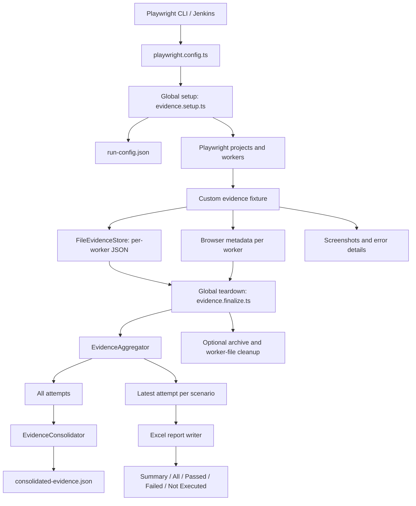
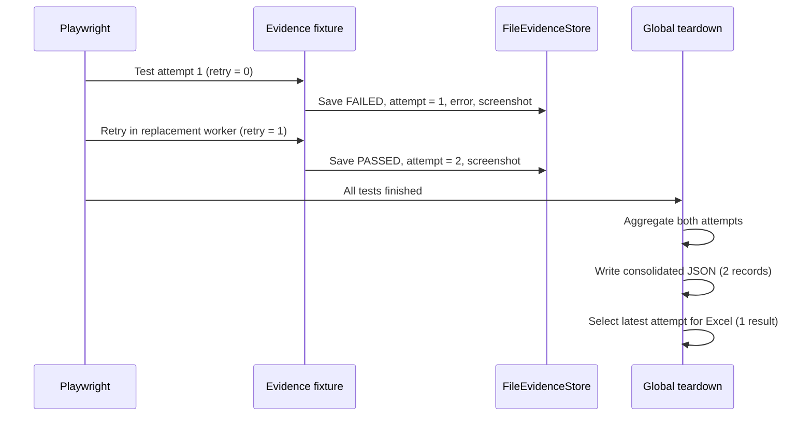

# EvidenceFactory — Playwright Evidence & Excel Reporting

A reusable, file-backed evidence reporting framework for Playwright + TypeScript. EvidenceFactory records test outcomes, browser/runtime metadata, screenshots, errors, and retries; consolidates worker output; and generates an Excel execution report.

> **Integration scope:** This guide documents the integration and behavior validated in the reference repository. Some import paths and configuration interfaces depend on the exact EvidenceFactory version you copy. Preserve the existing `evidenceFactory/` implementation and use the examples below as an integration template.

## Features

- Automatic per-test evidence capture through a Playwright fixture.
- Supports Chrome, Microsoft Edge, Firefox, WebKit, and Chromium.
- Parallel-safe, project-aware worker files (`chrome-worker-0.json`, etc.).
- Retry-aware records: **all attempts** in consolidated JSON; **latest attempt** used for the final Excel result.
- Captures failure details and screenshots when the browser/page fixture initializes successfully.
- Records actual browser name, channel, version, headless mode, device classification, and execution mode.
- Consumer-owned schemas for evidence columns and Summary sections.
- Five Excel worksheets: **Summary**, **All**, **Passed**, **Failed**, **Not Executed**.
- Works with Playwright global setup/teardown and CI/Jenkins-style execution.

## Architecture



### Retry lifecycle



## Prerequisites

- Node.js and npm, compatible with your Playwright version.
- A TypeScript Playwright project (`@playwright/test`).
- Required browser binaries installed on the executing machine/agent.
- An `EVIDENCE_RUN_ID` for **every** evidence-enabled run.

```bash
npm install --save-dev @playwright/test typescript
npx playwright install
# Installed branded browsers, if needed:
npx playwright install chrome msedge
```

On Linux CI agents, browser OS dependencies may also be required (`npx playwright install --with-deps`, where supported). Chrome/Edge branded installations may require additional permissions.

## Add EvidenceFactory to a new repository

### 1. Copy the framework

Copy the **entire** `evidenceFactory/` directory from the reference implementation, preserving its relative layout and `index.ts` exports. The validated integration uses these paths:

```text
new-playwright-repo/
├── evidenceFactory/
│   ├── index.ts
│   ├── evidence-factory.ts
│   ├── fixtures/
│   │   ├── evidence.fixture.ts
│   │   ├── evidence.setup.ts
│   │   └── evidence.finalize.ts
│   ├── store/
│   │   ├── file-evidence-store.ts
│   │   └── worker-evidence-cleaner.ts
│   └── aggregation/
│       ├── evidence-aggregator.ts
│       └── evidence-consolidator.ts
├── configLayer/schema/evidence/
│   ├── evidence-schema.ts
│   └── summary-schema.ts
├── automationLayer/tests/
│   └── login.spec.ts
├── playwright.config.ts
└── package.json
```

The actual framework can contain additional modules (Excel writers, report configuration, archives, utilities, and types). **Copy those too**; the tree above is a map of key integration points, not an exhaustive package manifest.

### 2. Define consumer-owned report schemas

The consuming repository owns its report columns and Summary layout. The validated reference schema uses these evidence columns:

```text
scenarioId, scenarioName, status, policyNumber, customerNumber,
premium, attempt, workerId, startTime, endTime, durationMs,
error, mode, device, browser, browserChannel, browserVersion, headless
```

Its Summary sections are:

```text
Run, Runtime, Browser, Results, Timing
```

Copy `configLayer/schema/evidence/evidence-schema.ts` and `summary-schema.ts` from the working repository as a starting point. **Keep their exported contracts** (`evidenceFields`, `summarySchema`, and `EvidenceData`) compatible with the framework. Customize the business-specific columns (for example, `policyNumber` or `premium`) without changing the shared evidence engine.

> The precise schema object shapes are implementation-specific; do not replace the working schema definitions with a guessed structure.

### 3. Configure Playwright

`playwright.config.ts` (example matching the validated integration):

```ts
import { defineConfig, devices } from '@playwright/test';
import { evidenceFields } from './configLayer/schema/evidence/evidence-schema';
import { summarySchema } from './configLayer/schema/evidence/summary-schema';

export default defineConfig({
  testDir: '.',
  testMatch: ['automationLayer/tests/**/*.spec.ts'],
  fullyParallel: true,
  forbidOnly: !!process.env.CI,
  retries: process.env.CI ? 2 : 0,
  workers: process.env.CI ? 1 : undefined,

  metadata: {
    evidence: { evidenceFields, summarySchema },
  },

  globalSetup: './evidenceFactory/fixtures/evidence.setup.ts',
  globalTeardown: './evidenceFactory/fixtures/evidence.finalize.ts',

  reporter: [['html', { outputFolder: 'playwright-report', open: 'never' }]],

  use: {
    trace: 'on-first-retry',
    screenshot: 'only-on-failure',
    video: 'retain-on-failure',
  },

  projects: [
    { name: 'chrome', use: { ...devices['Desktop Chrome'], channel: 'chrome' } },
    { name: 'edge', use: { ...devices['Desktop Chrome'], channel: 'msedge' } },
    { name: 'firefox', use: { ...devices['Desktop Firefox'] } },
    { name: 'webkit', use: { ...devices['Desktop Safari'] } },
    { name: 'chromium', use: { ...devices['Desktop Chrome'] } },
  ],
});
```

The reference repository also has a separate `framework` project and test exclusions; retain those if you are migrating its full test suite. `--workers=N` overrides the CI default when concurrent execution is desired.

### 4. Write an evidence-enabled test

Import `test` and `expect` from **the EvidenceFactory fixture**, not directly from `@playwright/test`:

```ts
// automationLayer/tests/login.spec.ts
import { test, expect } from '../../evidenceFactory/fixtures/evidence.fixture';
import { EvidenceData } from '../../configLayer/schema/evidence/evidence-schema';

test('TC-001: Verify successful login and evidence reporting', async ({
  page,
  evidence,
}) => {
  // Add business context early so it is available even if a later assertion fails.
  evidence.add({
    [EvidenceData.scenarioId]: 'TC-001',
    [EvidenceData.scenarioName]: 'Verify successful login and evidence reporting',
  });

  await page.goto('https://www.saucedemo.com/');
  await page.locator('[data-test="username"]').fill('standard_user');
  await page.locator('[data-test="password"]').fill('secret_sauce');
  await page.locator('[data-test="login-button"]').click();

  await expect(page).toHaveURL(/inventory\.html/);
  await expect(page.locator('[data-test="title"]')).toHaveText('Products');

  await evidence.screenshot('TC-001-successful-login');
});
```

**Fixture API:**

| API | Purpose |
| --- | --- |
| `evidence.add({ ... })` | Merge business data into the current test's evidence record. |
| `await evidence.screenshot('name')` | Save a screenshot and attach it to the Playwright result. |
| Automatic fixture teardown | Record final status, timing, browser metadata, screenshots, and first error. |

Execution metadata is set by the fixture **after** business data is merged, so tests cannot overwrite the actual browser/channel/version/headless values.

### 5. Run the tests

**Single browser**

```bash
EVIDENCE_RUN_ID="RUN-$(date +%Y%m%d-%H%M%S)" \
  npx playwright test automationLayer/tests/login.spec.ts \
  --project=chrome --reporter=line
```

**Five browsers in parallel**

```bash
EVIDENCE_RUN_ID="RUN-$(date +%Y%m%d-%H%M%S)" \
  npx playwright test automationLayer/tests/login.spec.ts \
  --project=chrome --project=edge --project=firefox \
  --project=webkit --project=chromium \
  --workers=5 --reporter=line
```

**Simulate CI/Jenkins settings locally**

```bash
CI=true EVIDENCE_RUN_ID="JENKINS-LOCAL-$(date +%Y%m%d-%H%M%S)" \
  npx playwright test automationLayer/tests/login.spec.ts \
  --project=chromium --reporter=line
```

**CI with five concurrent workers**

```bash
CI=true EVIDENCE_RUN_ID="JENKINS-PARALLEL-$(date +%Y%m%d-%H%M%S)" \
  npx playwright test automationLayer/tests/login.spec.ts \
  --project=chrome --project=edge --project=firefox \
  --project=webkit --project=chromium \
  --workers=5 --reporter=line
```

### 6. Inspect generated output

Typical layout:

```text
results/<EVIDENCE_RUN_ID>/
├── run-config.json
├── evidence/
│   └── consolidated-evidence.json
├── metadata/
│   ├── browser-chrome-worker-0.json
│   └── browser-firefox-worker-1.json
├── screenshots/
│   └── ...png
└── reports/
    └── execution-report-<EVIDENCE_RUN_ID>.xlsx
```

The per-worker evidence JSON files are temporary: successful finalization can clean them up after consolidation and report generation. The optional archive configuration may also affect which run folders remain on disk.

**Excel sheets:** `Summary`, `All`, `Passed`, `Failed`, `Not Executed`.

- `All` and status-specific sheets represent the **final/latest attempt** for each scenario execution.
- `consolidated-evidence.json` preserves **every recorded attempt**, including failures later recovered by a retry.
- In mixed-browser runs, the single-value **Summary browser fields are intentionally blank** if browser configurations differ. Each individual evidence record still contains its browser metadata.

**Inspect evidence using Node.js (no Python required):**

```bash
RUN_ID="YOUR_ACTUAL_RUN_ID" node - <<'NODE'
const fs = require('node:fs');
const path = require('node:path');
const file = path.join('results', process.env.RUN_ID, 'evidence', 'consolidated-evidence.json');
const records = JSON.parse(fs.readFileSync(file, 'utf8'));
console.table(records.map(r => ({
  scenario: r.scenarioName,
  status: r.status,
  attempt: r.attempt,
  workerId: r.workerId,
  browser: r.data?.browser,
  browserVersion: r.data?.browserVersion,
  hasError: Boolean(r.error),
})));
console.log('Total recorded attempts:', records.length);
NODE
```

Replace `YOUR_ACTUAL_RUN_ID` with the run ID printed by setup/finalization. Do not include angle-bracket placeholders literally.

## Retry behavior

Playwright's `testInfo.retry` starts at `0`; EvidenceFactory stores `attempt = testInfo.retry + 1`.

| Playwright attempt | Evidence attempt | Example result |
| --- | --- | --- |
| Initial | 1 | FAILED |
| First retry | 2 | PASSED |

After a failure, Playwright normally starts a replacement worker. The project-aware worker IDs therefore remain distinct (`chrome-worker-0`, `chrome-worker-1`, etc.). For a failed-then-passed test, Playwright reports **flaky**; consolidated JSON has two attempts; final Excel reporting uses the latest `PASSED` attempt.

### Optional controlled retry smoke test

Create a **temporary** `automationLayer/tests/evidence-retry.spec.ts`:

```ts
import { test, expect } from '../../evidenceFactory/fixtures/evidence.fixture';
import { EvidenceData } from '../../configLayer/schema/evidence/evidence-schema';

test('TC-RETRY-001: Verify evidence retry handling', async ({ page, evidence }, testInfo) => {
  evidence.add({
    [EvidenceData.scenarioId]: 'TC-RETRY-001',
    [EvidenceData.scenarioName]: 'Verify evidence retry handling',
  });
  await page.goto('https://www.saucedemo.com/');
  expect(testInfo.retry, 'First attempt intentionally fails').toBeGreaterThan(0);
  await expect(page).toHaveTitle(/Swag Labs/);
  await evidence.screenshot('retry-success');
});
```

```bash
EVIDENCE_RUN_ID="RUN-$(date +%Y%m%d-%H%M%S)" \
  npx playwright test automationLayer/tests/evidence-retry.spec.ts \
  --project=chrome --retries=1 --reporter=line
```

Expected: `1 flaky`, final evidence count `1`, consolidated JSON count `2` (FAILED then PASSED). Remove or exclude this intentionally flaky smoke test from normal application test runs.

## Jenkins integration

Example **Declarative Pipeline** (`Jenkinsfile`) for a Unix-like Jenkins agent with Node.js and browser dependencies already provisioned:

```groovy
pipeline {
  agent any

  environment {
    CI = 'true'
  }

  stages {
    stage('Install dependencies') {
      steps {
        sh 'npm ci'
        sh 'npx playwright install chromium'
      }
    }

    stage('Playwright + EvidenceFactory') {
      steps {
        script {
          // BUILD_TAG normally includes job and build identifiers.
          // Normalize characters before using the value in a path.
          env.EVIDENCE_RUN_ID = "JENKINS-${env.BUILD_NUMBER}-${env.BUILD_TAG.replaceAll(/[^A-Za-z0-9_-]/, '-')}"
        }
        sh '''
          npx playwright test automationLayer/tests/login.spec.ts \
            --project=chromium --reporter=line
        '''
      }
    }
  }

  post {
    always {
      archiveArtifacts artifacts: 'results/**/reports/*.xlsx,results/**/evidence/consolidated-evidence.json,results/**/screenshots/**/*.png',
                       allowEmptyArchive: true
      archiveArtifacts artifacts: 'playwright-report/**,test-results/**',
                       allowEmptyArchive: true
    }
  }
}
```

**Jenkins notes:**

1. Ensure the agent has Node.js, browser binaries, and required system libraries. `npx playwright install chromium` installs only Chromium; add other browsers if running other projects.
2. Give each build a unique `EVIDENCE_RUN_ID` and preferably an isolated Jenkins workspace. For parallel Jenkins stages using a **shared logical run**, coordinate the workspace and finalization carefully; separate Playwright invocations should not independently finalize the same run directory.
3. The reference `playwright.config.ts` defaults to **one worker when `CI=true`**. Use `--workers=5` to enable five workers on a sufficiently provisioned agent.
4. Archive artifacts in `post { always { ... } }` so reports survive test failures, provided global teardown completes.
5. A successful local `CI=true` run validates CI settings but **does not substitute for a real Jenkins agent run**.
6. Jenkins agents may need network access to the application under test and permission to write to the configured results directory.

## Configuration and operational notes

| Setting | Meaning |
| --- | --- |
| `EVIDENCE_RUN_ID` | Required; isolates one logical Playwright execution and its report artifacts. |
| `EVIDENCE_RESULTS_DIR` | Optional results root; defaults to `results`. |
| `TEST_MODE` | Optional execution label; defaults to `E2E`. |
| `CI` | Enables CI-specific Playwright retries/workers according to your config. |
| `--workers=N` | Controls Playwright concurrency and overrides the config default. |
| `--retries=N` | Controls retry count and overrides the config default. |

**Important constraints:**

- The fixture depends on Playwright's `page` and `browser` fixtures. If a browser fails **before fixture initialization**, no scenario evidence is recorded; Playwright still reports the launch failure.
- A screenshot can fail if the page is already closed; the fixture logs a warning and continues recording the test where possible.
- Browser metadata files are per worker; mixed browser configurations intentionally leave Summary browser fields blank.
- Browser versions are collected from the **running** browser rather than hardcoded in the config.
- The evidence fixture must be imported by each evidence-enabled spec. Tests importing directly from `@playwright/test` do not automatically get this custom evidence fixture.
- The consumer's `EvidenceData` values are business fields; `scenarioId` at the record root is based on Playwright's `testInfo.testId`. Keep this distinction in mind when mapping report columns.
- Do not run the intentionally failing retry smoke test as part of routine green builds.

## Troubleshooting

| Symptom | Likely cause / action |
| --- | --- |
| `EVIDENCE_RUN_ID is required` | Set the environment variable before invoking Playwright. |
| `Chromium distribution 'chrome' is not found` | Install branded Chrome (`npx playwright install chrome`) or use the `chromium` project. |
| `Evidence count: 0` after browser-launch failure | The browser/page fixture did not initialize; inspect the Playwright error. |
| `Multiple browser configurations detected` | Expected for a mixed-browser run; browser fields in Summary remain blank. |
| Consolidated file not found (`ENOENT`) | Confirm the **current** run ID and whether cleanup/archiving removed older runs. |
| Fewer evidence records than attempts | Excel/final count uses latest attempts; inspect consolidated JSON for all attempts. |
| Unexpectedly sequential CI run | `workers: process.env.CI ? 1 : undefined`; pass `--workers=N` if desired. |
| Screenshot missing | Browser/page may have closed before capture; check logs and Playwright attachments. |

## Validated reference runs

The reference implementation was exercised successfully with:

- One Chrome test and one Chromium test in separate runs.
- Chrome + Chromium in parallel: **2 passed**, **2 distinct worker IDs**.
- Five browsers in parallel: **5 passed**, **5 evidence records**, **5 distinct workers**, **5 distinct browsers**.
- Controlled retry: **FAILED attempt 1** (`chrome-worker-0`) and **PASSED attempt 2** (`chrome-worker-1`) both preserved; Playwright reported `1 flaky`.
- Local CI simulation (`CI=true`): **5 passed** sequentially with one worker.
- Local CI simulation with `--workers=5`: **5 passed** in parallel.

The actual Excel file was generated in those runs, but its individual worksheet contents were **not independently inspected**. Execution on an actual Jenkins agent was **not yet validated**.

## Migration checklist

- [ ] Copy the complete `evidenceFactory/` implementation, including writers and supporting modules.
- [ ] Copy/adapt consumer-owned evidence and summary schemas without breaking their exports.
- [ ] Add metadata and global setup/teardown to `playwright.config.ts`.
- [ ] Import `test`/`expect` from `evidence.fixture.ts` in each evidence-enabled spec.
- [ ] Add business context with `evidence.add()` and screenshots with `evidence.screenshot()`.
- [ ] Install required browser binaries on local and CI machines.
- [ ] Set a unique `EVIDENCE_RUN_ID` per execution.
- [ ] Run `npx tsc --noEmit` and a single-browser smoke test.
- [ ] Verify parallel execution, retries, and consolidated JSON.
- [ ] Verify the five Excel sheets in the generated workbook using a spreadsheet viewer or your existing Node-based Excel tooling.
- [ ] Archive reports and evidence in Jenkins; validate on a real agent.

---

**Design principle:** application projects own their business evidence schema; EvidenceFactory owns the collection, worker isolation, consolidation, and report lifecycle.
