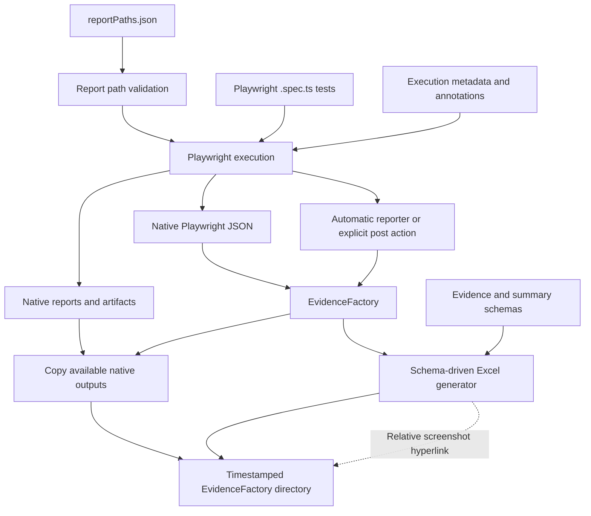

# EvidenceFactory — Playwright Test Evidence & Reporting

EvidenceFactory is a standalone post-execution reporting component used by this Playwright + TypeScript automation framework. It generates a schema-driven Excel execution report using the native Playwright JSON report and collects copies of available native reports and execution artifacts into a timestamped run directory. EvidenceFactory does not replace Playwright's native reporting mechanisms or modify their original output locations.

## 1. What EvidenceFactory provides

- Execution summary and detailed test results in Excel.
- Execution metadata collected from the running tests.
- Native full-page failure screenshot hyperlinks.
- Test annotations and retry information.
- Support for multiple Playwright workers and browser projects.
- Copies of available native reports and execution artifacts.
- Independent timestamped output directories.
- Local, generic CI and Jenkins execution support.
- Report generation after successful and failed test executions.
- Excel generation independent of Allure and Java.

## 2. Relevant implementation files

| File / component | Responsibility |
| --- | --- |
| `automationLayer/common/executionEnvironmentMetadata.ts` | Captures available execution metadata as test annotations. |
| `playwright.config.base.ts` | Configures native Playwright reporters and execution artifacts. |
| `playwright.brands.config.ts` | Configures Insurance brand projects and native reporters. |
| `configLayer/execution/reportPaths.json` | Centralized report output locations. |
| `configLayer/execution/validateReportPaths.cjs` | Validates configured report paths before execution and cleanup. |
| `configLayer/execution/commonJob/runner.cjs` | Existing Common Job discovery and execution orchestration. |
| `configLayer/execution/commonJob/reporter.cjs` | Existing Common Job inventory and execution summary reporting. |
| `reportingLayer/reporterHelper.ts` | Existing shared reporting and annotation utility used by test specifications. |
| `reportingLayer/reporters/brand-allure-reporter.ts` | Existing brand-specific Allure reporter. |
| `reportingLayer/reporters/evidenceReporter.ts` | Lightweight automatic post-execution trigger. |
| `reportingLayer/evidenceFactory.ts` | Processes native JSON results and orchestrates evidence generation. |
| `reportingLayer/evidenceArtifacts.ts` | Creates run directories, copies reports and resolves screenshot hyperlinks. |
| `reportingLayer/excel/excelGenerator.ts` | Generates the Excel workbook. |
| `reportingLayer/excel/excelStyles.ts` | Defines Excel styling behaviour. |
| `reportingLayer/excel/excelStyleConfig.ts` | Defines Excel styling configuration. |
| `reportingLayer/excel/missingFields.ts` | Supports missing evidence field handling. |
| `reportingLayer/schema/evidence-schema.ts` | Defines detailed execution evidence fields. |
| `reportingLayer/schema/summary-schema.ts` | Defines execution summary fields. |
| `JenkinsfileCommonTests` | Common Job Jenkins integration. |
| `JenkinsfileTestsWithReport` | Standard Jenkins test and reporting integration. |

## 3. EvidenceFactory architecture



EvidenceFactory runs after Playwright execution has completed. The native Playwright JSON report is the mandatory reporting input. Native reports remain in their original locations. EvidenceFactory copies available reports without moving or deleting their source files.

## 4. Centralized report path configuration

All configurable report locations are defined in:

```text
configLayer/execution/reportPaths.json
```

Default configuration:

```json
{
    "json": "results.json",
    "junit": "results.xml",
    "playwrightHtml": "playwright-report",
    "allureResults": "allure-results",
    "allureReport": "allure-report",
    "testResults": "test-results",
    "commonJob": "common-job",
    "evidenceFactoryOutput": "evidence-reports"
}
```

Report producers, report consumers and existing tests that verify production report locations should use this configuration. Native report locations must match the approved locations enforced by `validateReportPaths.cjs`. The `evidenceFactoryOutput` location remains configurable, subject to repository containment and report path safety validation. Temporary test-specific output files may retain their isolated locations. Common Job discovery may preserve a temporary `PLAYWRIGHT_JSON_OUTPUT_FILE` override for discovery-specific testing. Actual Common Job execution always uses the configured native JSON location. The EvidenceFactory output directory must remain independent of native report locations. The configured EvidenceFactory output directory must not be:

- The repository root.
- Outside the repository.
- Identical to a native report location.
- Inside a native report directory.
- A parent directory of a native report location.
- An overlapping legacy report cleanup location.

Run the validator from the repository root:

```bash
node configLayer/execution/validateReportPaths.cjs
```

Invalid report configuration must prevent test execution and destructive report cleanup. Only approved generated-output locations should be used for report cleanup. Repository containment alone does not establish that a directory is safe to delete.

## 5. Output directory structure

EvidenceFactory creates a unique directory beneath the configured `evidenceFactoryOutput` location. Representative output using the default configuration:

```text
evidence-reports/
└── Britannia-run-2026-11-24T11-00-00-000/
    ├── Britannia-report.xlsx
    ├── results.json
    ├── results.xml
    ├── playwright-report/
    │   ├── index.html
    │   └── data/
    ├── allure-results/
    ├── allure-report/
    ├── test-results/
    │   └── example-test-chromium/
    │       ├── test-failed-1.png
    │       ├── trace.zip
    │       └── video.webm
    └── common-job/
        ├── inventory.json
        └── results-summary.json
```

The actual contents depend on the reports and execution artifacts available for the current execution. The Excel workbook and copied native reports are placed directly inside the run directory without additional EvidenceFactory-specific report subdirectories. The timestamp uses the execution machine's local time and is derived from the native JSON execution start time. If a directory already exists with the same name, a numeric suffix is appended. The configured EvidenceFactory output directory is excluded from native report collection. The legacy `custom-test-reports` directory is not collected by EvidenceFactory.

## 6. Test integration and execution metadata

EvidenceFactory does not require a custom Playwright test fixture. Existing tests may continue using native Playwright fixtures or their own extended fixtures without modification.

```ts
import { test, expect } from '@playwright/test';
test('example', async ({ page }) => {
    await page.goto('https://example.com');
    await expect(page).toHaveTitle(/Example/);
});
```

EvidenceFactory does not require tests to initialize report directories or generate Excel reports. Available execution metadata is captured during test execution and recorded as Playwright annotations. Metadata may include:

- Host operating system and device information.
- Browser engine and browser version.
- Browser channel.
- Viewport.
- Headless execution mode.
- Supported remote execution capabilities.
- Business-specific test annotations.

Metadata availability depends on the execution environment and whether the relevant capture mechanism was invoked during the test. Missing metadata must not be replaced with fabricated values. EvidenceFactory collects available annotations across retry attempts.

## 7. Native failure screenshots and execution artifacts

Full-page failure screenshots are configured through native Playwright settings:

```ts
screenshot: { mode: 'only-on-failure', fullPage: true },
```

Playwright generates screenshots in its configured native test output directory. EvidenceFactory identifies native screenshot attachments from the JSON report and resolves their corresponding copied files. The latest available matching failure screenshot is linked from Excel. The screenshot column is defined in the evidence schema:

```ts
{
    field: 'screenshot',
    label: 'Screenshot',
    order: 18,
    type: 'hyperlink',
    linkText: 'View Screenshot'
}
```

Screenshot hyperlinks are relative to the EvidenceFactory run directory. Example:

```text
test-results/example-test-chromium/test-failed-1.png
```

Preserve the complete run directory when moving, downloading or sharing evidence. A test that passes on retry may retain a screenshot from an earlier failed attempt. Video and trace collection remain controlled by the existing Playwright configuration. EvidenceFactory does not independently enable these artifacts.

## 8. Prerequisites

- Repository-supported Node.js and npm versions.
- Existing dependencies installed using the repository lockfile.
- Required Playwright browser binaries installed.
- Application environment configuration and credentials.
- Native Playwright JSON reporting enabled.
- Execution from the repository root.

EvidenceFactory does not require additional dependencies or changes to existing dependency versions. Allure and Java are not prerequisites for Excel report generation.

## 9. Local execution

Install dependencies and required browsers:

```bash
npm ci
npx playwright install
```

On supported Linux CI agents, install browser system dependencies if required:

```bash
npx playwright install --with-deps
```

Validate report paths and TypeScript:

```bash
node configLayer/execution/validateReportPaths.cjs
npx --no-install tsc --noEmit
```

Run Playwright using the existing application project selection and configuration.

```bash
npx playwright test -c <playwright-config>
```

Replace the configuration placeholder with an actual repository configuration. Existing project-specific npm scripts may also be used. When the configured EvidenceFactory reporter is active, `onExit()` automatically invokes the standalone generator after native reporter finalization. Actual test execution must have started and the JSON must pass the preliminary freshness check. Manual generation is available when the automatic trigger is disabled or unavailable, or regeneration is required:

```bash
npm run evidence:generate
```

For manual generation, run the reporting command even when tests fail, provided all sources belong to that execution. Do not invoke it again after successful automatic generation unless regeneration is intended. VS Code and CLI reporter overrides may bypass the automatic reporter. Global setup failures before any test starts do not trigger automatic generation. Runtime compatibility remains to be verified. Do not generate evidence after discovery-only execution.

### Environment variables

| Variable | Purpose |
| --- | --- |
| `EVIDENCEFACTORY_AUTO_GENERATE` | Automatic generation is enabled unless set to `false`. Manual and Jenkins generation are unaffected. |
| `EVIDENCEFACTORY_PROJECT` | Explicit project or brand used for report naming. |
| `EVIDENCEFACTORY_JSON_FILE` | Optional explicit JSON input path. Must resolve to the configured `json` location in `reportPaths.json`. Defaults to that location. |
| `EVIDENCEFACTORY_ALLURE_REPORT_DIR` | Optional inclusion of the current execution's generated Allure HTML report. Must resolve to the configured `allureReport` location in `reportPaths.json`. |
| `PROJECT` | Application project fallback for report naming. |
| `PRODUCT` | Product label for the Excel report. |
| `ENV` | Execution environment. |
| `CI` | Identifies CI execution when set to `true`. |

EvidenceFactory always uses the approved native report locations defined in `reportPaths.json`. The JSON and Allure environment variables cannot redirect EvidenceFactory to alternative report locations. Unauthorized report source overrides are rejected before reading the native JSON report or creating an EvidenceFactory run directory. Generated Allure HTML is excluded when `EVIDENCEFACTORY_ALLURE_REPORT_DIR` is unset or empty. Only include generated Allure HTML that belongs to the current execution.

### macOS / Linux

```bash
export EVIDENCEFACTORY_PROJECT=britannia
export EVIDENCEFACTORY_AUTO_GENERATE=false
npm run evidence:generate
```

### Windows PowerShell

```powershell
$env:EVIDENCEFACTORY_PROJECT = 'britannia'
$env:EVIDENCEFACTORY_AUTO_GENERATE = 'false'
npm run evidence:generate
```

The project value is illustrative. Use the actual application project or brand.

## 10. Generic CI execution

Use an isolated workspace for each independent execution. The CI workflow should: 1\. Install the existing pinned dependencies and required browsers. 2\. Validate report paths before cleanup or test execution. 3\. Ensure native report sources belong to the current execution. 4\. Execute Playwright using the existing configuration. 5\. Generate EvidenceFactory reports after execution. 6\. Archive the complete EvidenceFactory run directory. 7\. Preserve the original Playwright execution result. Example for Bash-compatible CI agents:

```bash
node configLayer/execution/validateReportPaths.cjs || exit 1
export EVIDENCEFACTORY_AUTO_GENERATE=false

test_exit_code=0
npx playwright test -c "$PLAYWRIGHT_CONFIG" || test_exit_code=$?
evidence_exit_code=0
npm run evidence:generate || evidence_exit_code=$?
if [ "$test_exit_code" -ne 0 ]; then
    exit "$test_exit_code"
fi
exit "$evidence_exit_code"
```

This example assumes a clean execution workspace, valid environment configuration and current-run report sources. Configure artifact publication to run even when tests fail. Resolve the EvidenceFactory artifact location from `reportPaths.json` and retain the complete generated run directory.

## 11. Jenkins execution

EvidenceFactory integration is provided in:

- `JenkinsfileCommonTests`
- `JenkinsfileTestsWithReport`

The existing Jenkins test execution, credentials, environment selection and native report publication remain responsible for their original functionality. Both Jenkins pipelines set `EVIDENCEFACTORY_AUTO_GENERATE = 'false'` so the existing post action owns evidence generation. The intended integration workflow is: 1\. Validate centralized report paths. 2\. Prepare the execution workspace. 3\. Execute Playwright. 4\. Evaluate the test execution result. 5\. Publish existing native reports. 6\. Generate EvidenceFactory reports when execution was prepared. 7\. Archive the generated EvidenceFactory run directory. Invalid report path configuration must fail the build before test execution or destructive cleanup. EvidenceFactory generation failures are handled separately from the original test execution result. Existing native JUnit, Playwright HTML and Allure publication mechanisms remain in place. Generated Allure HTML is collected only when `EVIDENCEFACTORY_ALLURE_REPORT_DIR` is explicitly supplied and resolves to the configured `allureReport` location. The generated Allure HTML report must belong to the current execution. Jenkins agents must use separate workspaces for independent parallel executions. The existing Jenkins shell steps require an appropriate shell environment. Windows Jenkins agents require compatible command execution configuration.

## 12. Report freshness and parallel execution

EvidenceFactory copies available native reports. File existence alone does not establish that a report belongs to the current execution. The automatic reporter requires `onTestBegin()` and checks that the JSON is a file with modification time at least as recent as reporter initialization. This preliminary check does not establish ownership of JSON or freshness of optional reports. Manual and Jenkins generation do not use this reporter guard. Before generating evidence, ensure all report sources belong to the completed execution. Do not reuse stale JSON, JUnit, HTML, Allure or Common Job reports. Generate evidence before starting another execution that may overwrite native reports. Multiple workers and browser projects within one Playwright execution are handled by the native JSON reporter. Independent parallel executions require isolated workspaces because native report paths are shared within a checkout. Unique EvidenceFactory run directories do not provide isolation for concurrent native report generation. Sharded executions require an explicitly configured report merge or separate evidence generation strategy.

## 13. Validation checklist

- [ ] Centralized report path validation succeeds.
- [ ] Invalid and overlapping report paths are rejected before cleanup.
- [ ] Unauthorized EvidenceFactory JSON source overrides are rejected.
- [ ] Unauthorized EvidenceFactory Allure source overrides are rejected.
- [ ] Common Job discovery preserves temporary JSON output overrides.
- [ ] Common Job execution uses the configured native JSON location.
- [ ] TypeScript compilation succeeds.
- [ ] Automatic generation after successful and failed Athena and Insurance runs.
- [ ] Discovery-only execution does not generate evidence.
- [ ] Missing or stale JSON prevents automatic generation.
- [ ] Multiple workers and browser projects generate evidence once per invocation.
- [ ] Jenkins does not generate duplicate evidence.
- [ ] Manual generation works with the automatic trigger disabled.
- [ ] VS Code reporter compatibility is verified.
- [ ] Native JSON belongs to the current execution.
- [ ] EvidenceFactory generates Excel after successful execution.
- [ ] EvidenceFactory generates Excel after failed execution.
- [ ] Existing native reports remain in their original locations.
- [ ] Available native reports are copied into the run directory.
- [ ] Execution metadata and annotations appear where available.
- [ ] Failure screenshots are full-page screenshots.
- [ ] Relative Excel screenshot hyperlinks open the matching files.
- [ ] Retry evidence is handled correctly.
- [ ] Multiple workers and browser projects are supported.
- [ ] Independent parallel executions use isolated workspaces.
- [ ] Excel generation works without Allure and Java.
- [ ] Historical EvidenceFactory run directories remain intact.
- [ ] macOS and Windows local execution are verified.
- [ ] Jenkins archives the generated run directory after test failures.

### Existing Common Job regression tests

```bash
node --test configLayer/execution/commonJob/runner.test.cjs
node --test configLayer/execution/commonJob/reports.test.cjs
node --test configLayer/execution/commonJob/reporter.test.cjs
node --test configLayer/execution/commonJob/suiteSelection.test.cjs
```

## 14. Troubleshooting

| Symptom | What to check |
| --- | --- |
| Report path validation fails | Check `reportPaths.json`, repository boundaries and overlapping locations. |
| Native JSON report missing | Confirm JSON reporting is enabled for the selected configuration. |
| Automatic report missing | Check reporter registration, CLI or VS Code overrides, the automatic-generation flag, actual test start and JSON freshness. |
| Duplicate evidence | Check whether automatic and explicit generation are both enabled. |
| Excel report missing | Confirm EvidenceFactory was invoked with a valid current-run JSON report. |
| Incorrect project name | Check `EVIDENCEFACTORY_PROJECT` and `PROJECT`. |
| Product information missing | Check `PRODUCT`. |
| Execution metadata missing | Confirm metadata capture occurred during the test. |
| Screenshot hyperlink fails | Preserve the complete run directory and verify the copied screenshot exists. |
| Allure HTML report missing | Confirm the current-run Allure HTML report exists at the configured `allureReport` location and supply that location explicitly. |
| JSON source override rejected | Ensure `EVIDENCEFACTORY_JSON_FILE` resolves to the configured `json` location. |
| Allure source override rejected | Ensure `EVIDENCEFACTORY_ALLURE_REPORT_DIR` resolves to the configured `allureReport` location. |
| Reports contain older results | Verify native report freshness before evidence generation. |
| Jenkins artifacts missing | Check post-execution generation and artifact archiving. |
| Concurrent jobs overwrite reports | Use separate execution workspaces. |
| Browser fails to start | Check browser installation and execution environment dependencies. |

## 15. Implementation guidance

- Keep EvidenceFactory independent of Playwright test execution.
- Keep configurable report locations centralized.
- Preserve existing native reporting mechanisms.
- Copy native reports without moving or deleting their source files.
- Preserve schema-driven Excel reporting.
- Preserve relative screenshot hyperlinks.
- Keep existing dependency versions unchanged.
- Do not commit generated evidence or native reports.
- Restrict access to reports containing sensitive information.
- Update `.gitignore` if configured output locations change.

Native reports, screenshots, traces and videos may contain sensitive information. Excel annotation filtering does not sanitize copied native reports. Complete integration verification and resolve outstanding cleanup safety and report freshness limitations before removing the legacy reporting implementation.
