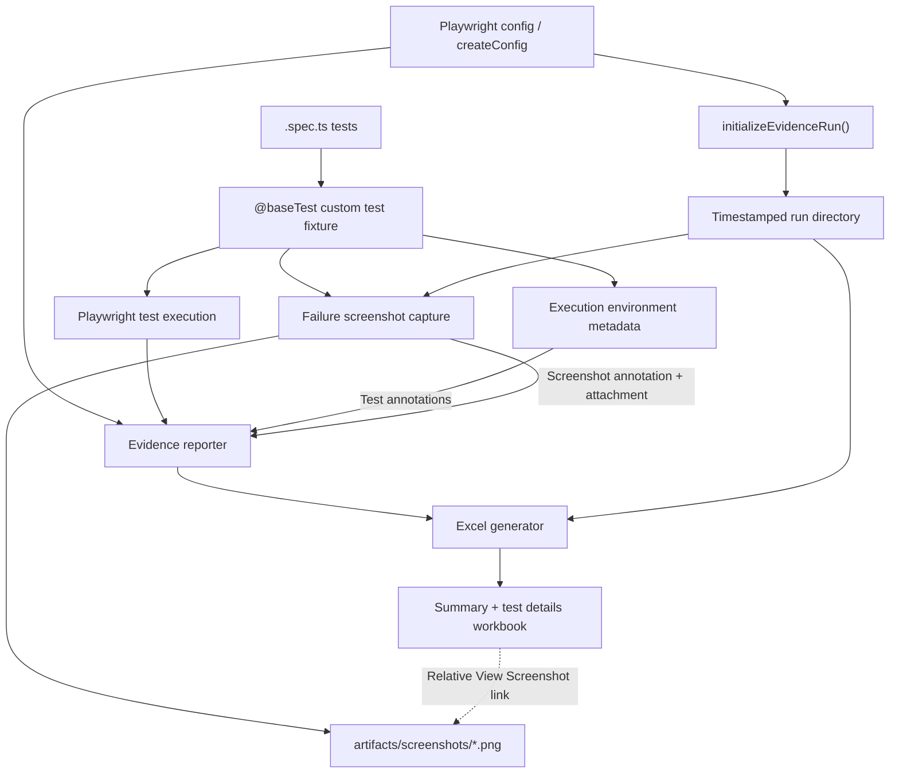
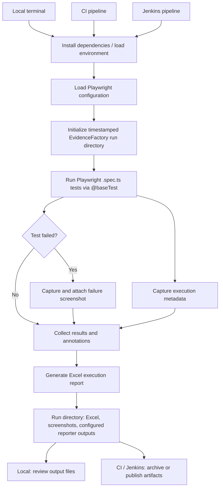

# EvidenceFactory — Playwright Test Evidence & Reporting

EvidenceFactory is the reporting and evidence layer used by this Playwright + TypeScript automation framework. It combines a custom Playwright `test` fixture, execution-environment metadata, failure screenshots, and an Excel execution report in a run-specific output directory.

This README describes the implementation and how to run it locally, in a generic CI environment, and in Jenkins. **Adapt the example environment variables, Playwright project names, and CI commands to your repository's actual configuration.**

## 1. What EvidenceFactory provides

- **Custom Playwright fixture:** Tests import `test` and `expect` from `@baseTest` instead of directly from `@playwright/test`.
- **Execution metadata:** Captures information such as host OS, browser, viewport, headless mode, and supported remote-device capabilities (for example, BrowserStack metadata).
- **Failure screenshots:** Captures full-page screenshots when a test fails, attaches them to the Playwright test result, and records a relative screenshot path for reporting.
- **Excel reporting:** Generates a workbook with an execution summary and test details. The report can show a **View Screenshot** hyperlink for tests with screenshot evidence.
- **Run isolation:** Places Excel reports, screenshots, and other reporter outputs under a timestamped directory for each execution.

## 2. Relevant implementation files

The paths below describe the known implementation. Adjust any filename or directory if it differs in your checkout.

| File / component | Responsibility |
| --- | --- |
| `baseTest.ts` | Exports the extended `test` fixture, `expect`, and Playwright types. Adds evidence-related test behavior. |
| `executionEnvironmentMetadata.ts` | Implements `captureExecutionEnvironmentMetadata(page)` and adds environment metadata to test annotations. |
| `configLayer/evidenceFactory/evidenceRunDirectory.ts` | Creates and exposes the run-specific output paths through `initializeEvidenceRun()`. |
| `evidenceReporter.ts` | Collects test results and annotations for reporting. |
| `excelGenerator.ts` | Creates the Excel workbook, summary, details, and schema-driven hyperlinks. |
| Playwright configuration / configuration factory | Calls `loadEnvironment(project)`, initializes EvidenceFactory paths, and configures reporters. |

The reporting schema supports fields such as:

```ts
interface SchemaField {
    readonly field: string;
    readonly label: string;
    readonly order: number;
    readonly type?: 'text' | 'hyperlink';
    readonly linkText?: string;
}
```

A screenshot column can be configured with:

```ts
{
    field: 'screenshot',
    label: 'Screenshot',
    order: 18,
    type: 'hyperlink',
    linkText: 'View Screenshot'
}
```

### EvidenceFactory architecture (Mermaid)



The custom fixture supplies test evidence; the configuration establishes run-specific paths; and the reporter transforms results and annotations into the Excel workbook. The screenshot hyperlink points to a file within the same run directory.

## 3. Importing EvidenceFactory in tests

Use the custom fixture for tests:

```ts
import { test, expect, type Page } from '@baseTest';

test('example', async ({ page }) => {
    await page.goto('https://example.com');
    await expect(page).toHaveTitle(/Example/);
});
```

The `@baseTest` alias must be defined in the repository's TypeScript/Playwright configuration. The fixture should export its custom `test` and Playwright `expect`, plus Playwright types:

```ts
export { expect };
export type * from '@playwright/test';
```

`export type *` requires TypeScript 5.0 or newer and does **not** re-export Playwright runtime utilities such as `devices` or `defineConfig`. Import those directly from `@playwright/test` where needed.

**Important:** Importing `test` from `@playwright/test` bypasses the custom EvidenceFactory fixture. Tests that use EvidenceFactory behavior should import `test` from `@baseTest`.

## 4. Output directory structure

Each execution creates a directory beneath `test-results` with a project name and timestamp. A representative layout is:

```text
test-results/
└── <Project>-run-<timestamp>/
    ├── excel-report/
    │   └── <Project>-<Product>-report-run-<timestamp>.xlsx
    ├── artifacts/
    │   └── screenshots/
    │       └── failure-<browser>-<unique-name>.png
    ├── <JUnit output>
    ├── <Playwright output>
    └── <Allure output>
```

The exact reporter subdirectory names and generated files depend on the active configuration. The run-directory initializer provides the paths for the configured reporters.

Screenshot references in the Excel workbook are **relative** to the Excel report directory, for example:

```text
../artifacts/screenshots/failure-chromium-example.png
```

When moving or archiving results, preserve the entire run directory so these links continue to point to the screenshots. Desktop Excel may show a security prompt when opening links; support can vary in Excel Online.

## 5. Execution metadata and reporting

EvidenceFactory captures available execution details from the running test and records them as annotations. These are then consumed by the reporter and Excel generator.

Typical details include:

- Host operating system
- Browser and viewport
- Headless execution mode
- Remote device/platform information when supplied by the execution provider
- Test status and available failure evidence

The Excel summary includes the **Project** and, when available, **Product**. Its **Device** value is derived from the collected device metadata. If a test fails, the screenshot fixture attaches a full-page screenshot and makes its relative path available to the report.

**Retries:** The reporter may collect annotations across retry attempts. If a test fails and then passes on retry, evidence from the failed attempt can still be present in the final report. Interpret screenshot links with the test's retry history in mind.

### Execution workflow (Mermaid)



The execution flow is the same for local, generic CI, and Jenkins runs. CI/Jenkins additionally need artifact archiving configured so the complete run directory, including screenshots referenced by the Excel workbook, remains available after the job.

## 6. Prerequisites

- Node.js and npm versions supported by this repository
- Project dependencies installed (`npm ci` is preferred for reproducible CI runs)
- Playwright browser binaries installed for the browsers you intend to run
- Environment configuration required by your application and the framework
- TypeScript 5.0+ if using `export type * from '@playwright/test'`

Use the versions pinned by the repository's `package.json` and lockfile. Do not commit credentials or secret environment files.

## 7. Local execution

Run the commands from the repository root (`integration-tests`).

### Install dependencies

```powershell
npm ci
npx playwright install
```

On a fresh Linux CI agent, the browser installation may additionally require system dependencies:

```bash
npx playwright install --with-deps
```

### Check TypeScript and discover tests

```powershell
npx tsc --noEmit
npx playwright test --list
```

### Run tests

```powershell
# Run the suite using the repository's default Playwright configuration
npx playwright test

# Run one spec file
npx playwright test path/to/example.spec.ts

# Run a specific Playwright project (replace with a configured project name)
npx playwright test --project=<playwright-project-name>

# Run in headed mode when supported by the execution environment
npx playwright test --headed
```

If the repository selects an application **Project** or **Product** through environment variables, set them according to the existing `loadEnvironment(project)` and Playwright configuration logic before running. For example, only **if your configuration supports these variable names**:

```powershell
$env:PRODUCT = '<product-value>'
# Set any additional variables required by your existing configuration.
npx playwright test
```

`PRODUCT` is used by the known EvidenceFactory configuration when determining the product label for the report. A Playwright `--project` option is not necessarily the same as your application's project selection; use the repository's configuration as the source of truth.

### Inspect results

After execution, open the newly created directory:

```text
test-results/<Project>-run-<timestamp>/
```

Review the Excel workbook under `excel-report/` and screenshots under `artifacts/screenshots/`. Keep the directory structure intact when sharing results.

## 8. Generic CI execution

A CI job should:

1. Check out the repository.
2. Install the pinned Node.js version and dependencies.
3. Install Playwright browsers and required OS dependencies.
4. Supply the same non-secret configuration as local execution, with secrets coming from the CI secret store.
5. Run TypeScript validation and Playwright tests.
6. **Publish `test-results/` even when tests fail**, so the EvidenceFactory workbook and screenshots remain accessible.

Example CI shell steps:

```bash
npm ci
npx playwright install --with-deps
npx tsc --noEmit
npx playwright test
```

Example artifact configuration (illustrative pseudocode; use your CI provider's actual syntax):

```yaml
artifacts:
  when: always
  paths:
    - test-results/
```

**CI exit codes:** Allow Playwright's nonzero exit code to mark the test job as failed, but configure artifact publication to run regardless of the test outcome. Avoid cleaning `test-results/` before artifact collection.

For parallel CI jobs, each job should have an isolated workspace or a distinct output location to avoid collisions. If using multiple shards, collect artifacts from each shard and combine results only through a deliberately configured reporting/merge process.

## 9. Jenkins execution

The following is a **starter Declarative Pipeline**, not a copy of your current Jenkinsfile. It assumes a Linux Jenkins agent with `node`, `npm`, and `npx` available, and a checkout configured for the job.

```groovy
pipeline {
    agent any

    options {
        timestamps()
    }

    stages {
        stage('Checkout') {
            steps {
                checkout scm
            }
        }

        stage('Install Dependencies') {
            steps {
                sh 'npm ci'
                sh 'npx playwright install --with-deps'
            }
        }

        stage('TypeScript Validation') {
            steps {
                sh 'npx tsc --noEmit'
            }
        }

        stage('Playwright Tests') {
            steps {
                sh 'npx playwright test'
            }
        }
    }

    post {
        always {
            archiveArtifacts artifacts: 'test-results/**',
                             allowEmptyArchive: true,
                             fingerprint: true
        }
    }
}
```

### Jenkins configuration notes

- **Windows agents:** Replace `sh` with `bat` or `powershell`; `--with-deps` is primarily intended for supported Linux environments. Install the appropriate browser dependencies for the agent OS.
- **Credentials:** Use Jenkins credentials binding for tokens, passwords, and remote-browser credentials. Never embed secrets in a Jenkinsfile or report output.
- **Project / Product:** Pass values through Jenkins parameters or environment settings only after confirming the names expected by your Playwright configuration. For example, `PRODUCT` can populate the report's Product label when your config reads it.
- **JUnit publishing:** If your configured JUnit reporter produces XML inside `test-results/`, you can additionally publish it with Jenkins `junit`, using the actual XML path/pattern. Do not add a `junit` step until you have verified the generated location.
- **Artifact retention:** Set a retention policy appropriate to screenshot volume and report requirements.
- **Parallel builds:** Prefer separate workspaces/output directories to prevent concurrent jobs from writing to the same run folder.

### Windows Jenkins agent example

If your Jenkins agent is Windows and has the prerequisites installed, the core stages can use:

```groovy
stage('Install Dependencies') {
    steps {
        bat 'npm ci'
        bat 'npx playwright install'
    }
}

stage('Playwright Tests') {
    steps {
        bat 'npx playwright test'
    }
}
```

Keep the same `post { always { archiveArtifacts ... } }` block to retain evidence after failures.

## 10. Validation checklist

After a local or CI run, confirm:

- [ ] Tests resolve imports from `@baseTest`.
- [ ] `npx tsc --noEmit` passes.
- [ ] The expected project/product information appears in the Excel summary.
- [ ] Execution metadata appears in the report where supported.
- [ ] A failed test produces a full-page screenshot and test attachment.
- [ ] The Excel screenshot hyperlink opens the matching file when the run folder is preserved.
- [ ] CI/Jenkins retains the run folder as a downloadable artifact even if tests fail.

## 11. Troubleshooting

| Symptom | What to check |
| --- | --- |
| `Cannot find module '@baseTest'` | Check the alias mapping and TypeScript/Playwright configuration. |
| Custom metadata or screenshot behavior missing | Confirm the test imports `test` from `@baseTest`, not `@playwright/test`. |
| `@baseTest` does not export a symbol | `export type *` exposes types only. Import Playwright runtime utilities directly or explicitly re-export approved values. |
| Product displays as unknown | Check whether `PRODUCT` is set and whether the environment is loaded before EvidenceFactory reporter configuration. |
| Excel screenshot link fails | Keep `excel-report/` and `artifacts/screenshots/` in the same run directory and use a compatible spreadsheet application. |
| CI run has no artifacts | Ensure artifact archiving runs even after a failed Playwright command and that its glob includes `test-results/`. |
| CI browsers fail to start | Check browser installation, system dependencies, and the agent's OS/container image. |
| Multiple jobs overwrite outputs | Isolate workspaces or run-output paths. |

## 12. Implementation guidance

- Keep `baseTest.ts` as the shared test entry point for tests that need EvidenceFactory behavior.
- Keep output-path creation centralized in `evidenceRunDirectory.ts` rather than independently building paths in reporters.
- Preserve relative screenshot links so complete run directories remain portable.
- Avoid modifying generated evidence files during a run.
- Do not commit secrets or unnecessarily retain sensitive screenshots in CI artifacts.

---

**Repository-specific follow-up:** To make the CI and Jenkins examples fully executable without placeholders, align this README with your actual `package.json` scripts, `playwright.config.ts`/configuration factory, environment-loading rules, Jenkins agent OS, and reporter output paths.
