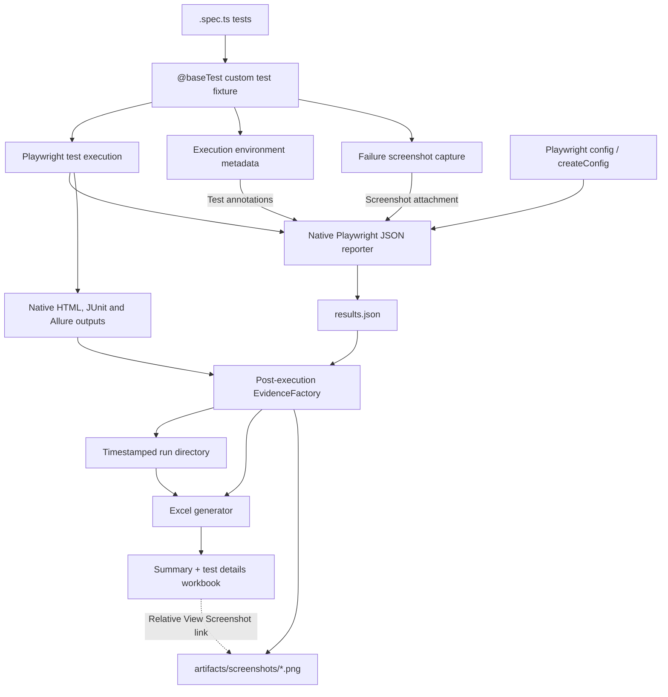
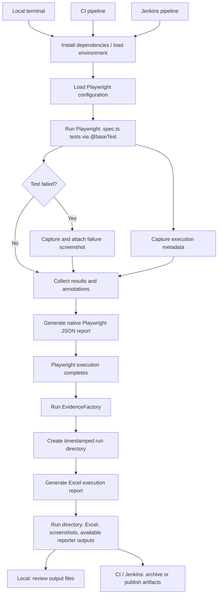

# EvidenceFactory — Playwright Test Evidence & Reporting

EvidenceFactory is the reporting and evidence layer used by this Playwright + TypeScript automation framework. It combines a custom Playwright `test` fixture, execution-environment metadata, failure screenshots, and an Excel execution report in a run-specific output directory.

EvidenceFactory generates its reports after Playwright execution has completed, using the native Playwright JSON report as its input.

This README describes the implementation and how to run it locally, in a generic CI environment, and in Jenkins. **Adapt the example environment variables, Playwright project names, and CI commands to your repository's actual configuration.**

## 1. What EvidenceFactory provides

- **Custom Playwright fixture:** Tests import `test` and `expect` from `@baseTest` instead of directly from `@playwright/test`.
- **Execution metadata:** Captures information such as host OS, browser, viewport, headless mode, and supported remote-device capabilities (for example, BrowserStack metadata).
- **Failure screenshots:** Captures full-page screenshots when a test fails and attaches them to the Playwright test result.
- **Excel reporting:** Generates a workbook with an execution summary and test details. The report can show a **View Screenshot** hyperlink for tests with screenshot evidence.
- **Post-execution reporting:** Processes the native Playwright JSON report independently of Playwright test execution.
- **Run-specific reporting:** Places Excel reports, screenshots, and copies of available native reporter outputs under a timestamped directory for each execution.

## 2. Relevant implementation files

The paths below describe the known implementation. Adjust any filename or directory if it differs in your checkout.

| File / component | Responsibility |
| --- | --- |
| `baseTest.ts` | Exports the extended `test` fixture, `expect`, and Playwright types. Captures execution metadata and full-page failure screenshots independently of EvidenceFactory. |
| `executionEnvironmentMetadata.ts` | Implements `captureExecutionEnvironmentMetadata(page)` and adds environment metadata to test annotations. |
| `evidenceFactory.ts` | Processes native Playwright JSON results, creates run-specific output paths, collects screenshots and native reports, and invokes the Excel generator. |
| `excelGenerator.ts` | Creates the Excel workbook, summary, details, and schema-driven hyperlinks. |
| Playwright configuration / configuration factory | Calls `loadEnvironment(project)` and configures native reporters. |

The reporting schema supports fields such as:

```ts
interface SchemaField {
    readonly field: string;
    readonly label: string;
    readonly order: number;
    readonly type?: 'text' | 'hyperlink';
    readonly linkText?: string;
}
```

A screenshot column can be configured with:

```ts
{
    field: 'screenshot',
    label: 'Screenshot',
    order: 18,
    type: 'hyperlink',
    linkText: 'View Screenshot'
}
```

### EvidenceFactory architecture (Mermaid)



The custom fixture supplies test evidence; Playwright records results, annotations and attachments in its native JSON report; and EvidenceFactory processes that report after execution to generate the Excel workbook. The screenshot hyperlink points to a file within the same run directory.

## 3. Importing EvidenceFactory in tests

Use the custom fixture for tests:

```ts
import { test, expect, type Page } from '@baseTest';

test('example', async ({ page }) => {
    await page.goto('https://example.com');
    await expect(page).toHaveTitle(/Example/);
});
```

The `@baseTest` alias must be defined in the repository's TypeScript/Playwright configuration. The fixture should export its custom `test` and Playwright `expect`, plus Playwright types:

```ts
export { expect };
export type * from '@playwright/test';
```

`export type *` requires TypeScript 5.0 or newer and does **not** re-export Playwright runtime utilities such as `devices` or `defineConfig`. Import those directly from `@playwright/test` where needed.

**Important:** Importing `test` from `@playwright/test` bypasses the custom fixture. Tests that require execution metadata and full-page failure screenshot behavior should import `test` from `@baseTest`.

The custom fixture does not initialize EvidenceFactory directories or generate Excel reports.

## 4. Output directory structure

After execution, EvidenceFactory creates a directory beneath `test-results` with a project name and timestamp. A representative layout is:

```text
test-results/
└── <Project>-run-<timestamp>/
    ├── excel-report/
    │   └── <Project>-report.xlsx
    ├── artifacts/
    │   └── screenshots/
    │       └── failure-<browser>-<unique-name>.png
    ├── junit/
    │   └── results.xml
    ├── playwright/
    │   ├── index.html
    │   └── data/
    ├── allure/
    │   ├── results/
    │   └── report/
    └── common-job/
```

The timestamp uses the execution machine's local time. For example:

```text
Britannia-run-2026-11-24T11-00-00-000/
```

If a directory already exists with the same name, a numeric suffix is appended.

The exact reporter subdirectories depend on the available native reports. EvidenceFactory copies existing reporter outputs without moving or deleting their original files.

The native Playwright JSON report (`results.json`) is used as the reporting input and is not copied into the EvidenceFactory run directory.

The Allure HTML report is collected only when its source directory is explicitly supplied through `EVIDENCEFACTORY_ALLURE_REPORT_DIR`.

Screenshot references in the Excel workbook are **relative** to the Excel report directory, for example:

```text
../artifacts/screenshots/failure-chromium-example.png
```

When moving or archiving results, preserve the entire run directory so these links continue to point to the screenshots. Desktop Excel may show a security prompt when opening links; support can vary in Excel Online.

## 5. Execution metadata and reporting

The custom fixture captures available execution details from the running test and records them as annotations. These are persisted by the native Playwright JSON reporter and then consumed by EvidenceFactory and the Excel generator.

Typical details include:

- Host operating system
- Browser and viewport
- Headless execution mode
- Remote device/platform information when supplied by the execution provider
- Test status and available failure evidence

The Excel summary includes the **Project** and, when available, **Product**. Its **Device** value is derived from the collected device metadata.

If a test fails, the screenshot fixture attaches a full-page screenshot using the attachment name:

```text
full-page-failure:<screenshot-filename>
```

EvidenceFactory identifies these attachments from the native JSON report, copies the screenshot files and calculates their relative Excel hyperlink paths.

**Retries:** EvidenceFactory collects annotations across retry attempts. If a test fails and then passes on retry, evidence from the failed attempt can still be present in the final report. Interpret screenshot links with the test's retry history in mind.

### Execution workflow (Mermaid)



The execution flow is the same for local, generic CI, and Jenkins runs. CI/Jenkins additionally need artifact archiving configured so the complete run directory, including screenshots referenced by the Excel workbook, remains available after the job.

## 6. Prerequisites

- Node.js and npm versions supported by this repository
- Project dependencies installed (`npm ci` is preferred for reproducible CI runs)
- Playwright browser binaries installed for the browsers you intend to run
- Environment configuration required by your application and the framework
- TypeScript 5.0+ if using `export type * from '@playwright/test'`
- Native Playwright JSON reporter enabled for the selected configuration

Use the versions pinned by the repository's `package.json` and lockfile. Do not commit credentials or secret environment files.

## 7. Local execution

Run the commands from the repository root (`integration-tests`).

### Install dependencies

```powershell
npm ci
npx playwright install
```

On a fresh Linux CI agent, the browser installation may additionally require system dependencies:

```bash
npx playwright install --with-deps
```

### Check TypeScript and discover tests

```powershell
npx tsc --noEmit
npx playwright test --list
```

### Run tests

Use a Playwright configuration that enables the native JSON reporter alongside the required existing reporters.

```powershell
# Run the suite using the selected Playwright configuration
npx playwright test -c <playwright-config>

# Run one spec file
npx playwright test -c <playwright-config> path/to/example.spec.ts

# Run a specific Playwright project (replace with a configured project name)
npx playwright test -c <playwright-config> --project=<playwright-project-name>

# Run in headed mode when supported by the execution environment
npx playwright test -c <playwright-config> --headed
```

If the repository selects an application **Project** or **Product** through environment variables, set them according to the existing `loadEnvironment(project)` and Playwright configuration logic before running.

For example, only **if your configuration supports these variable names**:

```powershell
$env:PRODUCT = '<product-value>'
# Set any additional variables required by your existing configuration.
npx playwright test -c <playwright-config>
```

`PRODUCT` is used by EvidenceFactory when determining the product label for the report. A Playwright `--project` option is not necessarily the same as your application's project selection; use the repository's configuration as the source of truth.

### Generate EvidenceFactory reports

After Playwright execution has completed, run EvidenceFactory separately, including when tests fail.

PowerShell:

```powershell
$env:EVIDENCEFACTORY_PROJECT = 'britannia'
$env:EVIDENCEFACTORY_JSON_FILE = 'results.json'

npx --no-install ts-node --transpile-only reportingLayer/evidenceFactory/evidenceFactory.ts
```

Bash / Zsh:

```bash
export EVIDENCEFACTORY_PROJECT=britannia
export EVIDENCEFACTORY_JSON_FILE=results.json

npx --no-install ts-node --transpile-only reportingLayer/evidenceFactory/evidenceFactory.ts
```

Ensure `results.json` belongs to the execution that has just completed. Do not generate evidence from an older JSON report after test discovery or an execution that did not produce a new report.

### EvidenceFactory environment variables

| Variable | Purpose |
| --- | --- |
| `EVIDENCEFACTORY_PROJECT` | Explicit application project or brand used for report naming. |
| `EVIDENCEFACTORY_JSON_FILE` | Native Playwright JSON report path. Defaults to `results.json`. |
| `EVIDENCEFACTORY_ALLURE_REPORT_DIR` | Optional source directory containing the current execution's generated Allure HTML report. |
| `PROJECT` | Application project fallback when `EVIDENCEFACTORY_PROJECT` is not supplied. |
| `PRODUCT` | Product label for the Excel report. |
| `ENV` | Execution environment. |
| `CI` | Identifies CI execution when set to `true`. |

### Inspect results

After EvidenceFactory generation, open the newly created directory:

```text
test-results/<Project>-run-<timestamp>/
```

Review the Excel workbook under `excel-report/` and screenshots under `artifacts/screenshots/`. Keep the directory structure intact when sharing results.

Generate and archive evidence before starting another Playwright execution that may clean the existing output directory.

## 8. Generic CI execution

A CI job should:

1. Check out the repository.
2. Install the pinned Node.js version and dependencies.
3. Install Playwright browsers and required OS dependencies.
4. Supply the same non-secret configuration as local execution, with secrets coming from the CI secret store.
5. Run TypeScript validation and Playwright tests.
6. Generate EvidenceFactory reports after Playwright execution, including when tests fail.
7. **Publish `test-results/` even when tests fail**, so the EvidenceFactory workbook and screenshots remain accessible.

Example CI shell steps:

```bash
npm ci
npx playwright install --with-deps
npx tsc --noEmit

# Use a configuration with native JSON reporting enabled.
test_exit_code=0
npx playwright test -c "$PLAYWRIGHT_CONFIG" || test_exit_code=$?

evidence_exit_code=0
if [ -f results.json ]; then
    npx --no-install ts-node --transpile-only \
        reportingLayer/evidenceFactory/evidenceFactory.ts \
        || evidence_exit_code=$?
else
    evidence_exit_code=1
fi

if [ "$test_exit_code" -ne 0 ]; then
    exit "$test_exit_code"
fi

exit "$evidence_exit_code"
```

The example assumes a clean execution workspace and a valid `PLAYWRIGHT_CONFIG` environment variable.

Example artifact configuration (illustrative pseudocode; use your CI provider's actual syntax):

```yaml
artifacts:
  when: always
  paths:
    - test-results/
```

**CI exit codes:** Preserve Playwright's nonzero exit code to mark the test job as failed, but configure EvidenceFactory generation and artifact publication to run regardless of the test outcome. Avoid cleaning `test-results/` before artifact collection.

For parallel CI jobs, each job should have an isolated workspace to avoid collisions. Multiple Playwright workers within a single execution are handled by Playwright's native JSON reporter.

If using multiple shards, collect artifacts from each shard and combine results only through a deliberately configured reporting/merge process.

## 9. Jenkins execution

EvidenceFactory integration is provided in:

- `JenkinsfileCommonTests`
- `JenkinsfileTestsWithReport`

EvidenceFactory runs after Playwright execution and native report publication, before artifact archiving.

The existing Jenkins test execution, credentials, environment selection and native reporter publication remain responsible for their original functionality.

The following is a **starter Declarative Pipeline**, not a copy of your current Jenkinsfile. It assumes a clean Linux Jenkins workspace with `node`, `npm`, and `npx` available, and a checkout configured for the job.

```groovy
pipeline {
    agent any

    options {
        timestamps()
    }

    stages {
        stage('Checkout') {
            steps {
                checkout scm
            }
        }

        stage('Install Dependencies') {
            steps {
                sh 'npm ci'
                sh 'npx playwright install --with-deps'
            }
        }

        stage('TypeScript Validation') {
            steps {
                sh 'npx tsc --noEmit'
            }
        }

        stage('Playwright Tests') {
            steps {
                sh 'npx playwright test -c "$PLAYWRIGHT_CONFIG"'
            }
            post {
                always {
                    script {
                        if (fileExists('results.json')) {
                            catchError(buildResult: 'UNSTABLE', stageResult: 'UNSTABLE') {
                                sh 'npx --no-install ts-node --transpile-only reportingLayer/evidenceFactory/evidenceFactory.ts'
                            }
                        } else {
                            unstable('Missing native Playwright JSON report')
                        }
                    }
                }
            }
        }
    }

    post {
        always {
            archiveArtifacts artifacts: 'test-results/**',
                             allowEmptyArchive: true,
                             fingerprint: true
        }
    }
}
```

### Jenkins configuration notes

- **Windows agents:** Replace `sh` with `bat` or `powershell`; `--with-deps` is primarily intended for supported Linux environments. Install the appropriate browser dependencies for the agent OS.
- **Credentials:** Use Jenkins credentials binding for tokens, passwords, and remote-browser credentials. Never embed secrets in a Jenkinsfile or report output.
- **Project / Product:** Pass values through Jenkins parameters or environment settings. `EVIDENCEFACTORY_PROJECT` determines the report naming prefix. `PRODUCT` can populate the report's Product label.
- **JUnit publishing:** Continue using the existing native JUnit report path (`results.xml`) for Jenkins publication.
- **Allure publishing:** Continue using the existing Allure publication step. Supply `EVIDENCEFACTORY_ALLURE_REPORT_DIR` only when the current execution's generated HTML report directory is available.
- **Artifact retention:** Set a retention policy appropriate to screenshot volume and report requirements.
- **Parallel builds:** Use separate workspaces to prevent concurrent jobs from writing to the same native output files.
- **List tests:** Do not generate EvidenceFactory reports for discovery-only executions.

### Windows Jenkins agent example

If your Jenkins agent is Windows and has the prerequisites installed, the core stages can use:

```groovy
stage('Install Dependencies') {
    steps {
        bat 'npm ci'
        bat 'npx playwright install'
    }
}

stage('Playwright Tests') {
    steps {
        bat 'npx playwright test -c "%PLAYWRIGHT_CONFIG%"'
    }
    post {
        always {
            script {
                if (fileExists('results.json')) {
                    catchError(buildResult: 'UNSTABLE', stageResult: 'UNSTABLE') {
                        bat 'npx --no-install ts-node --transpile-only reportingLayer/evidenceFactory/evidenceFactory.ts'
                    }
                } else {
                    unstable('Missing native Playwright JSON report')
                }
            }
        }
    }
}
```

Keep the same `post { always { archiveArtifacts ... } }` block to retain evidence after failures.

## 10. Validation checklist

After a local or CI run, confirm:

- [ ] Tests resolve imports from `@baseTest`.
- [ ] `npx tsc --noEmit` passes.
- [ ] Native Playwright JSON is generated for the current execution.
- [ ] EvidenceFactory runs after Playwright execution has completed.
- [ ] The expected project/product information appears in the Excel summary.
- [ ] Execution metadata appears in the report where supported.
- [ ] A failed test produces a full-page screenshot and test attachment.
- [ ] The Excel screenshot hyperlink opens the matching file when the run folder is preserved.
- [ ] Native Playwright HTML, JUnit and available Allure outputs are preserved.
- [ ] CI/Jenkins retains the run folder as a downloadable artifact even if tests fail.

### Regression tests

```bash
node --test configLayer/execution/commonJob/runner.test.cjs
node --test configLayer/execution/commonJob/reports.test.cjs
node --test reportingLayer/evidenceFactory/evidenceFactory.test.cjs
```

## 11. Troubleshooting

| Symptom | What to check |
| --- | --- |
| `Cannot find module '@baseTest'` | Check the alias mapping and TypeScript/Playwright configuration. |
| Custom metadata or screenshot behavior missing | Confirm the test imports `test` from `@baseTest`, not `@playwright/test`. |
| `@baseTest` does not export a symbol | `export type *` exposes types only. Import Playwright runtime utilities directly or explicitly re-export approved values. |
| Product displays as unknown | Check whether `PRODUCT` is available when EvidenceFactory runs. |
| Native JSON report missing | Confirm the selected Playwright configuration enables JSON reporting and writes to the expected path. |
| Excel report missing | Confirm EvidenceFactory was invoked after execution and received a valid JSON report. |
| Incorrect project name | Check `EVIDENCEFACTORY_PROJECT` and the application project selection. |
| Excel screenshot link fails | Keep `excel-report/` and `artifacts/screenshots/` in the same run directory and use a compatible spreadsheet application. |
| Allure HTML report missing | Confirm the current report exists and its directory is supplied through `EVIDENCEFACTORY_ALLURE_REPORT_DIR`. |
| Reports contain older results | Confirm all native reporter outputs belong to the current execution before running EvidenceFactory. |
| CI run has no artifacts | Ensure artifact archiving runs even after a failed Playwright command and that its glob includes `test-results/`. |
| CI browsers fail to start | Check browser installation, system dependencies, and the agent's OS/container image. |
| Multiple jobs overwrite outputs | Isolate workspaces. Timestamped EvidenceFactory directories do not isolate concurrent native Playwright executions. |

## 12. Implementation guidance

- Keep `baseTest.ts` as the shared test entry point for tests that need execution metadata and full-page failure screenshots.
- Keep the custom fixture independent of EvidenceFactory report generation.
- Keep output-path creation centralized in `evidenceFactory.ts`.
- Use native Playwright JSON as the input for post-execution reporting.
- Preserve relative screenshot links so complete run directories remain portable.
- Avoid modifying generated evidence files during a run.
- Generate EvidenceFactory reports before another execution cleans the native output directory.
- Do not commit secrets or unnecessarily retain sensitive screenshots or raw reporter data in CI artifacts.

---

**Repository-specific follow-up:** Validate the native Playwright JSON format, Excel schema compatibility, local execution commands, Jenkins publication paths and regression tests before removing the legacy reporting implementation.
